# Sakura Style（サクラスタイル）

Spring Boot と React で実装したファッションECサイトです。会員向けの買い物機能と、管理者向けの管理画面を備えています。

**お支払いはシミュレーションです。** チェックアウト時に実決済は行わず、注文を支払い済みとして扱います。

## 概要

Sakura Style は、お客様向けの買い物機能と管理画面を備えたフルスタックのファッションストアです。バックエンドは Spring Boot + JWT + PostgreSQL、フロントエンドは React + Bootstrap です。

## 技術スタック

| レイヤー | 技術 |
|-------|--------------|
| フロントエンド | React 19, React Router, Axios, Bootstrap 5, React Icons, Vite |
| バックエンド | Java 21, Spring Boot 3.4, Spring Security, Spring Data JPA, Hibernate, JWT, Bean Validation, Lombok, Maven |
| データベース | PostgreSQL |
| ドキュメント | Swagger / OpenAPI (springdoc) |

## 機能

### お客様
- 会員登録・ログイン・ログアウト
- 商品一覧・商品詳細
- 検索・カテゴリ絞り込み・価格ソート
- カート・チェックアウト（決済シミュレーション）
- 注文履歴・プロフィール

### 管理者
- ダッシュボード（商品・ユーザー・注文・売上）
- 商品のCRUD
- カテゴリのCRUD
- 注文管理・ステータス更新
- ユーザー管理（有効 / 無効）

## プロジェクト構成

```
Sakura Style/
├── backend/
│   ├── pom.xml
│   └── src/main/java/com/sakurastyle/
│       ├── config/          # セキュリティ、OpenAPI、初期データ、インポーター
│       ├── controller/      # RESTコントローラー
│       ├── dto/
│       ├── entity/
│       ├── exception/
│       ├── repository/
│       ├── security/        # JWT + UserDetails
│       ├── service/
│       └── SakuraStyleApplication.java
├── frontend/
│   ├── src/
│   │   ├── api/
│   │   ├── components/
│   │   ├── context/
│   │   └── pages/
│   └── package.json
├── docker-compose.yml
└── README.md
```

## ER図

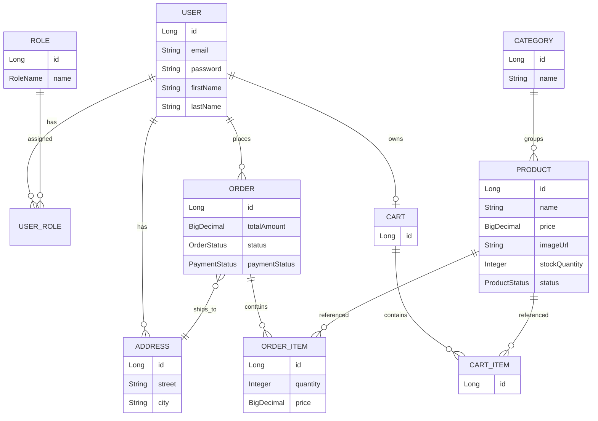

## セットアップ

### 必要な環境
- Java 21
- Maven 3.9+
- Node.js 20+
- PostgreSQL 14+

### 1. PostgreSQL

データベースを作成します:

```sql
CREATE DATABASE sakura_style;
```

必要に応じて環境変数、または `backend/src/main/resources/application.yml` の接続情報を変更してください:

```yaml
spring:
  datasource:
    url: jdbc:postgresql://localhost:5432/sakura_style
    username: postgres
    password: "1234"   # または SPRING_DATASOURCE_PASSWORD
```

ローカル用の既定値です。公開環境では `SPRING_DATASOURCE_PASSWORD` と `SAKURA_JWT_SECRET` を必ず上書きしてください。

Docker を使う場合:

```bash
docker compose up -d db
```

### ワンクリック起動（Windows）

**`start.bat`** をダブルクリックしてください。

実行内容:
- Java 21 を強制（PATH 上の Java 8 を回避）
- `sakura_style` DB が無い場合は作成（パスワード `1234`）
- バックエンドを **8081** で起動し、`/api/products` の応答を待機
- フロントエンドを **5173** で起動し、応答を待機
- 両方の準備完了後に http://localhost:5173 を開く

停止する場合は **`stop.bat`** をダブルクリックしてください。

> 既定の API ポートは **8081** です（`SERVER_PORT` で変更可）。

### 2. バックエンド

```bash
cd backend
mvn spring-boot:run
```

初回起動時の動作:
- ロールと初期ユーザーを投入
- DummyJSON から全カテゴリ（トップス / ドレス / アクセサリー / シューズ / ビューティー）のサンプル商品を **一度だけ** 取得し、`backend/src/main/resources/data/imported-products.json` に保存してから PostgreSQL へ投入
- 2回目以降はローカル JSON を再利用し、外部APIには依存しません
- 同名商品は重複登録しません

API ベースURL: `http://localhost:8081/api`

### 3. フロントエンド

```bash
cd frontend
npm install
npm run dev
```

アプリURL: `http://localhost:5173`

## テスト用アカウント

| 役割 | メール | パスワード |
|------|-------|----------|
| 管理者 | admin@sakurastyle.com | admin123 |
| お客様 | customer@sakurastyle.com | customer123 |

## Swagger URL

- Swagger UI: http://localhost:8081/swagger-ui.html
- OpenAPI JSON: http://localhost:8081/v3/api-docs

## API 概要

| プレフィックス | 用途 |
|--------|---------|
| `/api/auth` | 登録 / ログイン |
| `/api/products` | 商品閲覧（公開） |
| `/api/categories` | カテゴリ（公開） |
| `/api/cart` | カート（要ログイン） |
| `/api/orders` | チェックアウト・注文履歴 |
| `/api/users` | プロフィール |
| `/api/admin` | 管理ダッシュボード・CRUD |

## スクリーンショット

### ホームページ
ヒーロー画面とブランド訴求

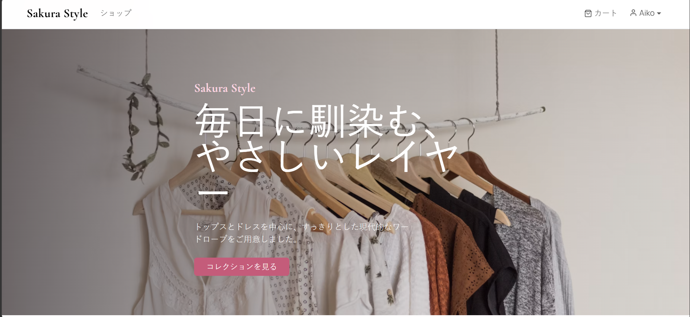

### 会員登録
新規アカウント作成画面

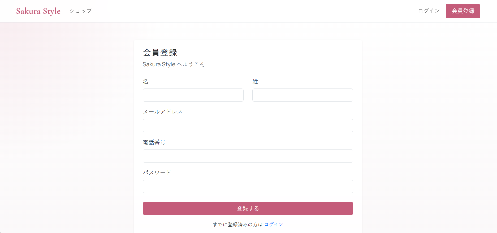

### ログイン
ログイン画面

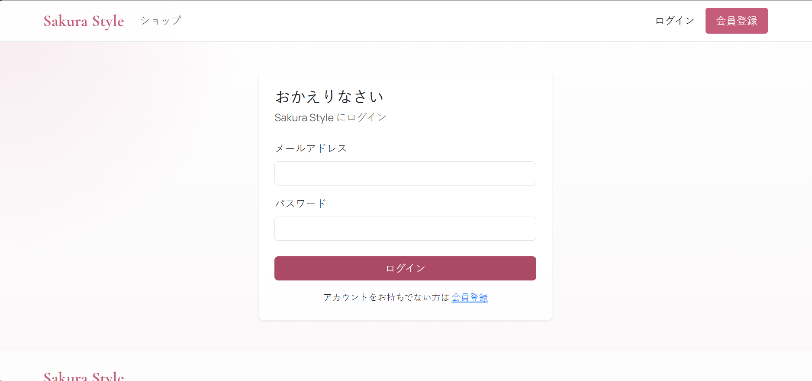

### ショップ（商品一覧）
検索・カテゴリ絞り込み・並び替え付きの商品一覧

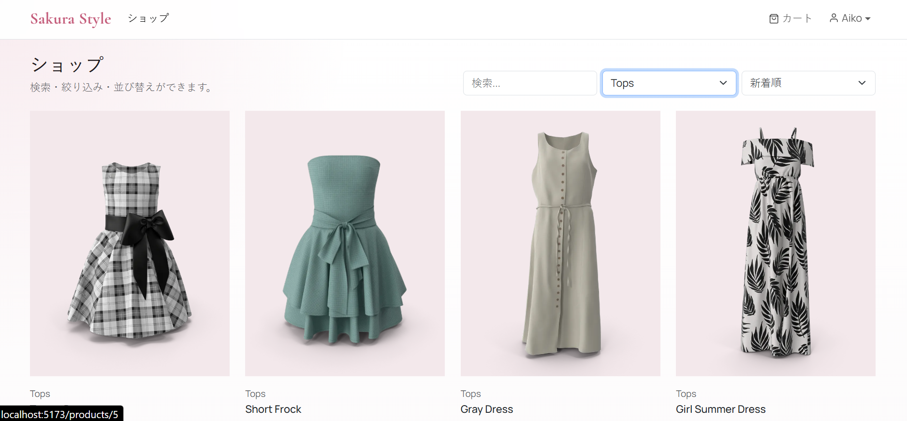

### 商品詳細
商品情報・在庫・カート追加

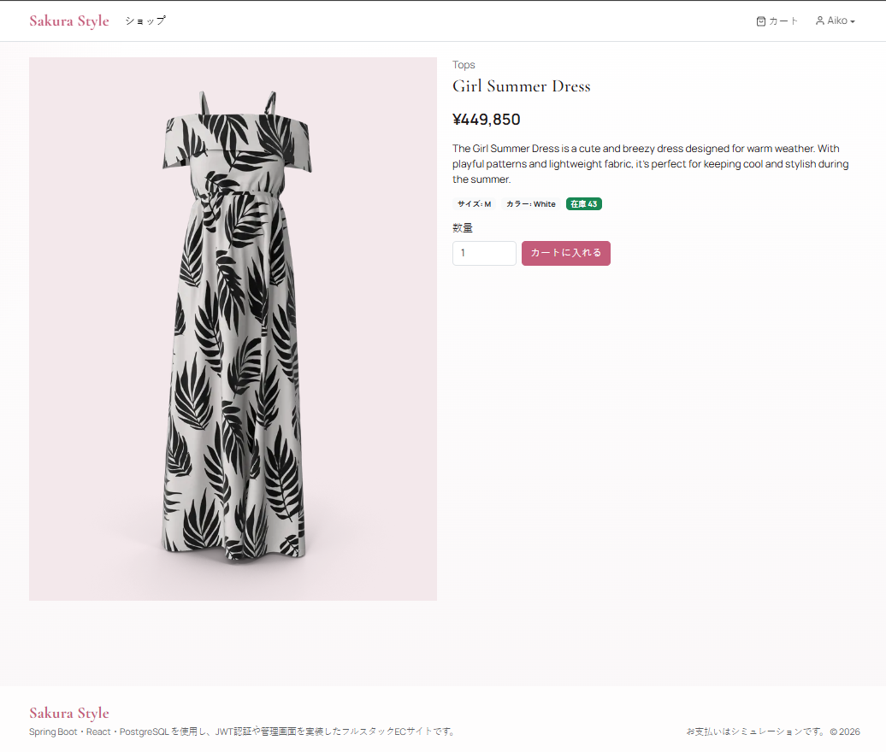

### ショッピングカート
カート追加後の画面（数量変更・削除・合計）

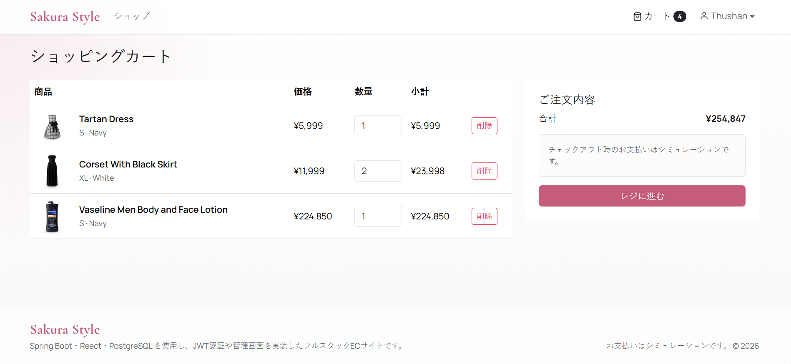

### チェックアウト
お届け先入力と注文確定（決済はシミュレーション）

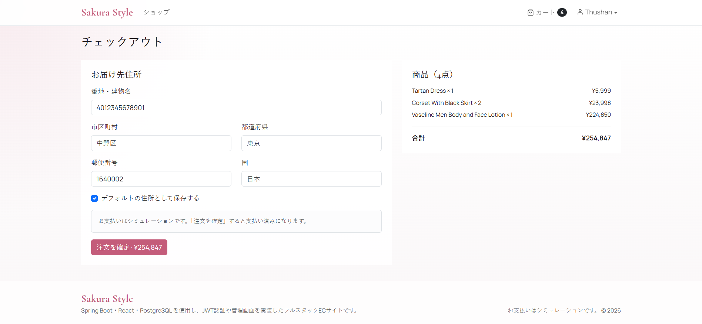

### 注文完了
注文確定後の詳細

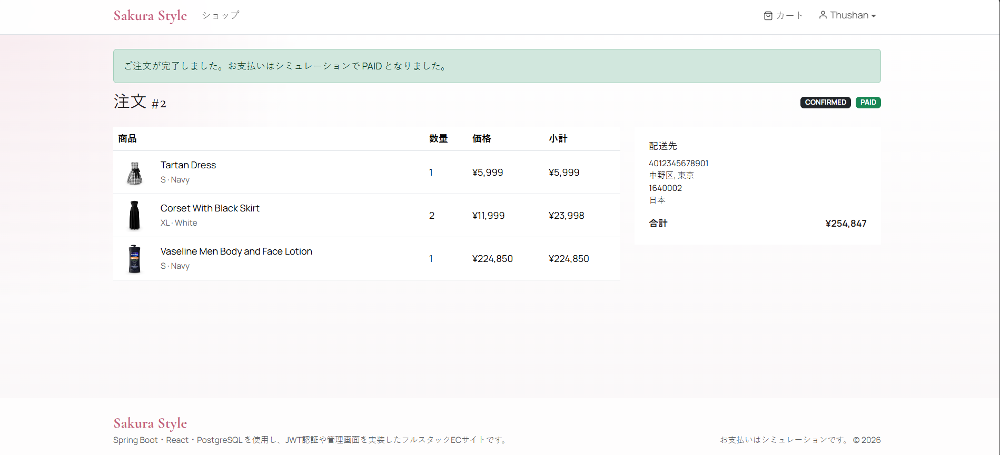

### 注文履歴
過去の注文一覧

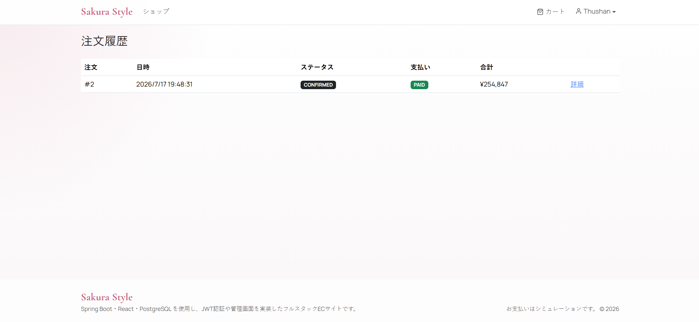

### プロフィール
マイプロフィール編集画面

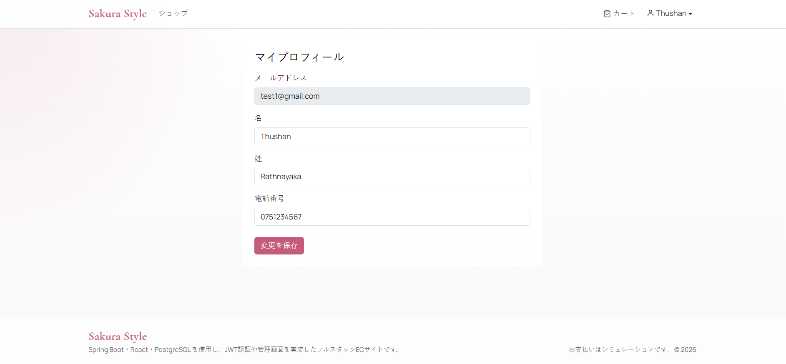

## 既知の制限

- 決済はシミュレーションのみ（注文は即 `PAID`）
- JWT は `localStorage` に保存（学習用の実装）
- 商品画像は1枚のみ
- サンプルインポーターは初回のみ DummyJSON に依存
- メール認証・パスワード再設定なし
- 本格的な在庫予約や配送連携は未実装（在庫数の単純減算のみ）

## 今後の改善案

- 実決済（Stripe など）
- リフレッシュトークンと httpOnly Cookie
- 商品画像アップロード
- ウィッシュリスト・レビュー
- 単体 / 結合テスト
- CI とデプロイ

## Docker（任意）

```bash
docker compose up --build
```

PostgreSQL、Spring Boot API、React フロント（nginx / ポート 3000）を起動します。

Docker Desktop が起動している必要があります。
